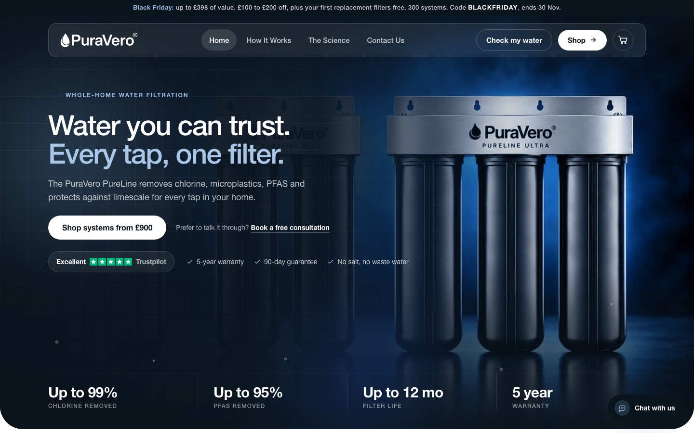
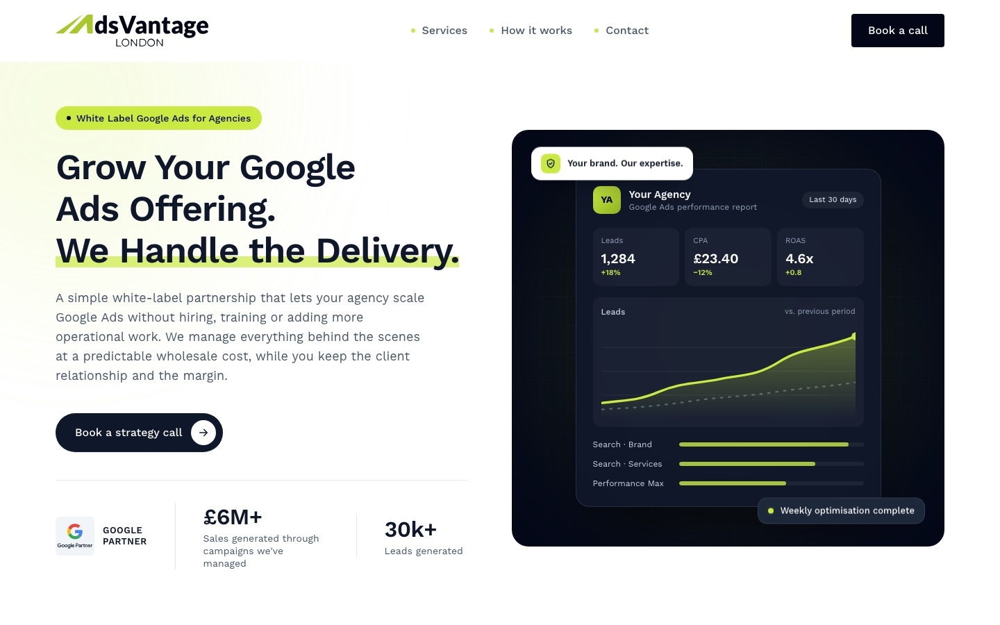
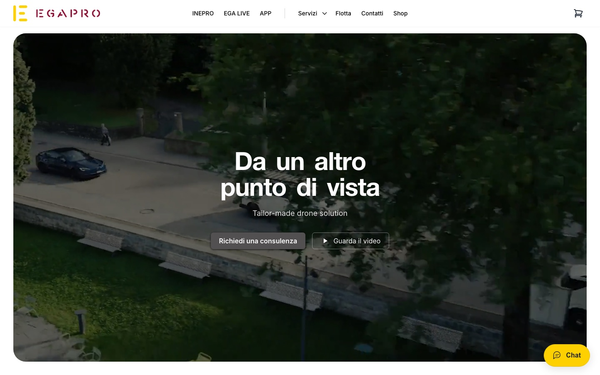
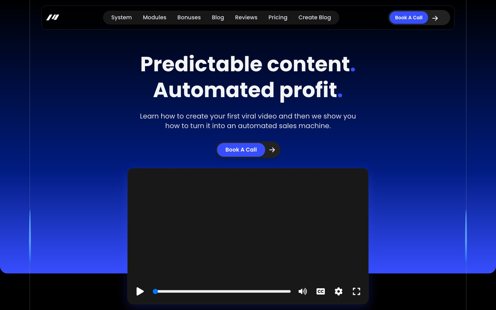
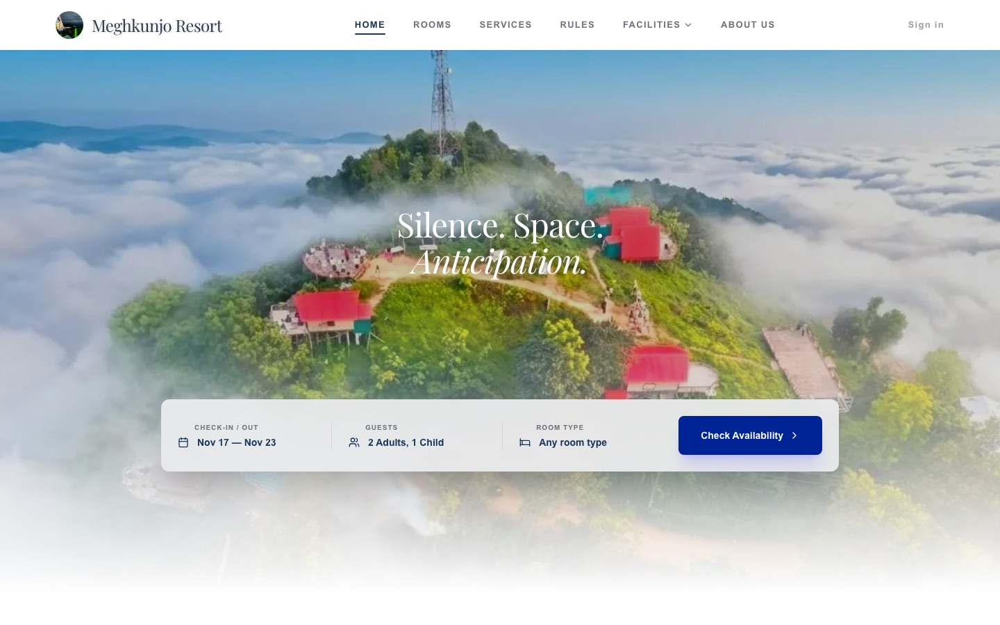
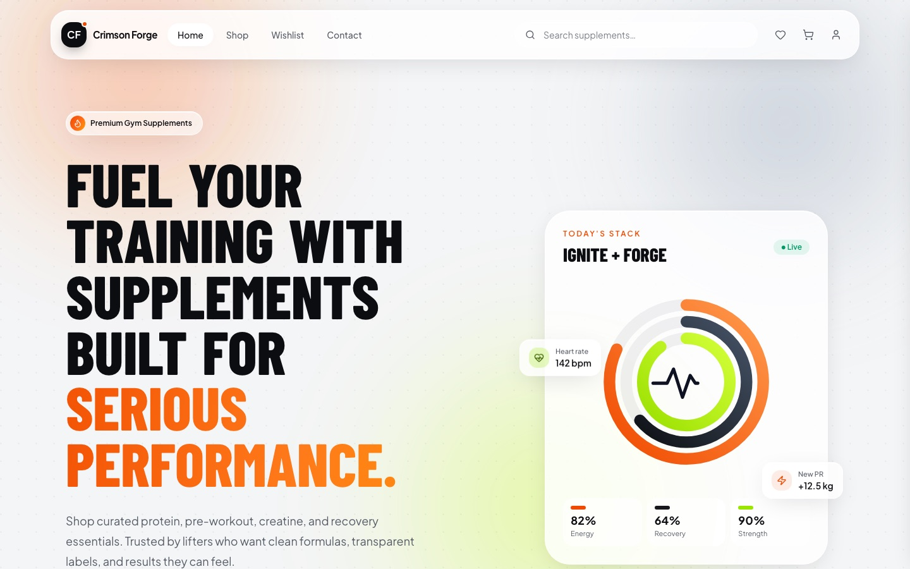

<!-- ===================== HEADER ===================== -->
<p align="center">
  
</p>

<p align="center">
  <a href="https://aayman-portfolio.vercel.app/">
    <picture>
      <source media="(prefers-color-scheme: dark)" srcset="https://readme-typing-svg.demolab.com?font=JetBrains+Mono&weight=600&size=22&duration=2600&pause=700&color=FFFFFF&center=true&vCenter=true&width=640&lines=I+build+SaaS+%26+multi-tenant+platforms;Headless+e-commerce+on+the+WooCommerce+API;bKash+%2B+Stripe+payment+integrations;SSO+%26+auth+with+NestJS+%2B+PostgreSQL;Fast%2C+SEO-friendly+Next.js+apps" />
      
    </picture>
  </a>
</p>

<p align="center">
  <a href="https://aayman-portfolio.vercel.app/"></a>
  <a href="https://www.linkedin.com/in/aayman-alfee-rahman"></a>
  <a href="mailto:ayman.alfi098@gmail.com"></a>
  <a href="https://drive.google.com/file/d/1U9zT_jM8RTq2AQZrSeAe6FP61lWSRXCF/view?usp=sharing"></a>
  
</p>

<!-- ===================== ABOUT ===================== -->
## `$ whoami`

Backend-focused full-stack developer. I ship **SaaS platforms, headless stores, payment flows and SSO** with TypeScript, Next.js, NestJS and PostgreSQL, for product teams and growing businesses.

```ts
const aayman = {
  role: "Full-Stack Developer",
  currentlyAt: "Wadi Taslim Technologies",
  basedIn: "Dhaka, Bangladesh",
  stack: {
    frontend: ["Next.js", "React", "TypeScript", "Tailwind CSS", "shadcn/ui"],
    backend: ["NestJS", "Node.js", "Express", "REST APIs"],
    data: ["PostgreSQL", "Prisma", "Drizzle", "MongoDB"],
    commerce: ["WooCommerce API", "bKash", "Stripe"],
  },
  exploring: ["Docker", "GitHub Actions", "WebSockets"],
  askMeAbout: ["Next.js", "NestJS", "SSO & auth", "Headless e-commerce"],
  funFact: "Sometimes I solve my code problems in my sleep 😴",
};
```

<!-- ===================== PROJECTS ===================== -->
## `$ ls ~/projects`

<table>
  <tr>
    <td width="50%" valign="top">
      <a href="https://www.puravero.com"></a>
      <h3><a href="https://www.puravero.com">PuraVero</a> <sub>· client work</sub></h3>
      Online store for a UK whole-home water filtration brand: shop, basket, checkout and a postcode water-report lookup.<br/>
      <b>Built:</b> frontend and backend, with products, basket and checkout on the WooCommerce API.<br/><br/>
      
      
    </td>
    <td width="50%" valign="top">
      <a href="https://www.adsvantagelondon.com"></a>
      <h3><a href="https://www.adsvantagelondon.com">AdsVantage London</a> <sub>· client work</sub></h3>
      Site for a London white-label Google Ads agency: services, FAQ and a partnership enquiry form.<br/>
      <b>Built:</b> frontend and backend, connected to the WooCommerce API.<br/><br/>
      
      
    </td>
  </tr>
  <tr>
    <td width="50%" valign="top">
      <a href="https://egapro.ch"></a>
      <h3><a href="https://egapro.ch">Egapro</a> <sub>· client work</sub></h3>
      Italian-language site for a Ticino drone-services company: services, fleet, shop and a client portal.<br/>
      <b>Built:</b> Next.js frontend, with the WooCommerce API for products and placing orders with payment methods.<br/><br/>
      
      
      
    </td>
    <td width="50%" valign="top">
      <a href="https://montreal-francais.vercel.app"></a>
      <h3><a href="https://montreal-francais.vercel.app">Montreal Français</a> <sub>· client work</sub></h3>
      Educational platform with interactive content, a blog, a booking system, pricing and contact pages.<br/>
      <b>Built:</b> includes an admin interface for writing and managing blog posts.<br/><br/>
      
      
    </td>
  </tr>
  <tr>
    <td width="50%" valign="top">
      <a href="https://meghkunjoresort.com"></a>
      <h3><a href="https://meghkunjoresort.com">Meghkunjo Resort</a> <sub>· client work</sub></h3>
      Booking site for an eco resort in Bandarban: availability search, rooms, dining and WhatsApp booking.<br/>
      <b>Built:</b> Next.js application with server-side rendering and bKash payment integration.<br/><br/>
      
      
      
    </td>
    <td width="50%" valign="top">
      <a href="https://github.com/aayman01/gym-front-end"></a>
      <h3>Protein store <sub>· personal project</sub></h3>
      Solo full-stack supplement store: NestJS + Prisma API with admin, public and customer routes, HttpOnly JWT cookies, CSRF protection, and checkout that updates orders and inventory in one transaction.<br/><br/>
      <a href="https://github.com/aayman01/gym-front-end">Frontend</a> ·
      <a href="https://github.com/aayman01/gym-admin">Admin panel</a> ·
      <a href="https://github.com/aayman01/gym-back">Backend API</a><br/><br/>
      
      
      
      
    </td>
  </tr>
</table>

<p align="center"><a href="https://aayman-portfolio.vercel.app/#work"><b>→ See them all on my portfolio</b></a></p>

<!-- ===================== EXPERIENCE ===================== -->
## `$ cat experience.log`

**MERN Stack Developer · Wadi Taslim Technologies** — *Aug 2025 – present · Hybrid*
- Develop scalable SaaS platforms with Next.js, TypeScript, NestJS, PostgreSQL and Drizzle ORM.
- Co-developed **VLife**, the centralised SSO platform other products authenticate through, sharing backend and frontend work equally with a senior engineer.
- On **Ezybizz**, a multi-tenant SaaS website builder: built the e-commerce template and a restaurant POS on an offline-capable API, plus per-template admin panels and bKash / Stripe payments.

**Front-End Developer · Amarlodge Ltd** — *Feb 2025 – Jul 2025 · Remote*
- Built SaaS admin dashboards (restaurant and clinic management) with Next.js and TypeScript.
- Improved a newspaper platform's performance and SEO with server-side rendering.

<!-- ===================== STACK ===================== -->
## `$ stack --list`

<p align="center">
  <br/>
  <br/>
  
</p>

<!-- ===================== STATS ===================== -->
## `$ git log --stats`

<p align="center">
  
</p>

<!-- Snake: generated daily by .github/workflows/snake.yml into the "output" branch -->
<p align="center">
  <picture>
    <source media="(prefers-color-scheme: dark)" srcset="https://raw.githubusercontent.com/aayman01/aayman01/output/github-snake-dark.svg" />
    
  </picture>
</p>

<!-- ===================== FOOTER ===================== -->
<p align="center">
  <b>Have a SaaS, store or dashboard to build?</b> <a href="mailto:ayman.alfi098@gmail.com">Let's talk →</a>
</p>


